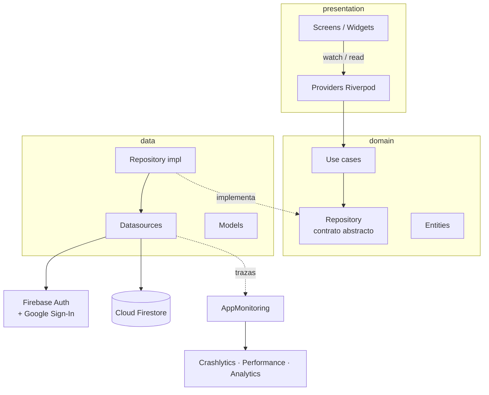
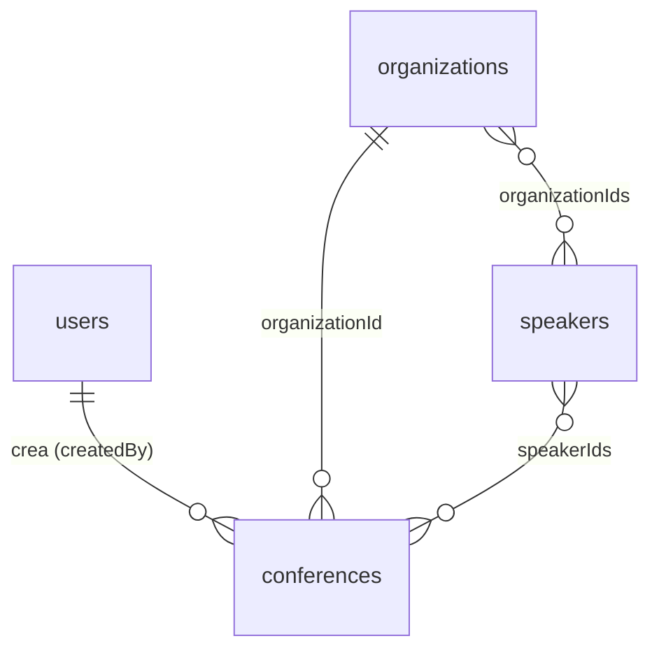

# Nova App


App móvil en **Flutter + Firebase** para gestionar eventos y conferencias: calendario, mapa de sedes, speakers y organizaciones, sincronizado en tiempo real con Firestore.

## Requisitos

| Herramienta | Versión |
|---|---|
| Flutter | 3.35 o superior (Dart 3.9) |
| Android Studio + Android SDK | JDK 17 o superior |
| Firebase CLI | `npm install -g firebase-tools` |
| FlutterFire CLI | `dart pub global activate flutterfire_cli` |
| Xcode + CocoaPods | Solo para iOS (macOS) |

## Funcionalidades

- Login con Google (Firebase Auth).
- Roles `admin` y `usuario` (campo `role` en `users/{uid}`); el admin ve el panel de administración.
- Crear, cancelar y restaurar eventos (los eventos se cancelan, no se borran).
- Calendario mensual de conferencias y cronograma por día.
- Mapa de eventos agrupados por sede.
- Speakers y organizaciones; un speaker puede editar su perfil desde la app.
- Monitoreo con Crashlytics, Performance (tiempos de carga) y Analytics.

## Arquitectura

Clean Architecture por feature + Riverpod. Solo la capa `data` conoce Firebase.



Flujo de una lectura: la pantalla observa un provider → el provider llama un caso de uso → el caso de uso usa el contrato del repositorio → la implementación pide los datos al datasource → el datasource escucha Firestore (`snapshots()`) y devuelve modelos convertidos en entidades. Los errores viajan como `Either<Failure, T>` (`fpdart`).

```
lib/
├── main.dart              # Inicializa Firebase y el monitoreo
├── app/                   # App, AuthGate y shell con el menú inferior
├── core/
│   ├── monitoring/        # Crashlytics, Performance y Analytics
│   ├── theme/             # Colores y tipografía
│   ├── utils/
│   └── widgets/           # Atomic design: atoms / molecules / organisms
└── features/
    ├── auth/              # data · domain · presentation
    ├── calendar/
    ├── events/
    ├── map/
    ├── organizations/
    └── speakers/
```

## Modelo de datos (Firestore)



`?` = el campo puede ser `null`. Los ids de documento los genera Firestore, salvo en `users`.

### 👤 `users/{uid}`: usuarios de la app

Un documento por persona que inicia sesión. Se crea en el primer login con Google; el id es el **uid de Firebase Auth**.

| Campo | Tipo | Qué guarda | Ejemplo |
|---|---|---|---|
| `email` | string | Correo de la cuenta de Google | `lau@ejemplo.com` |
| `displayName` | string | Nombre que muestra Google | `Laura López` |
| `photoUrl` | string? | Foto de perfil de Google | `https://…` |
| `role` | string | Permisos: `usuario` (por defecto) o `admin` | `usuario` |

### 📅 `conferences/{id}`: eventos

Cada evento o conferencia. Guarda una copia de los datos de la organización y de los speakers para mostrar calendario, mapa y detalle sin lecturas extra.

| Campo | Tipo | Qué guarda | Ejemplo |
|---|---|---|---|
| `name` | string | Título del evento | `Innovación educativa` |
| `description` | string | Descripción del evento | `Charla sobre…` |
| `date` | timestamp | Fecha y hora de **inicio** | `2026-10-08 15:00` |
| `endDate` | timestamp | Fecha y hora de **fin** (posterior al inicio) | `2026-10-08 16:30` |
| `organizationId` | string | Id del documento en `organizations` donde se hace | `aB3x…` |
| `organizationName` | string | Nombre de esa organización (copia) | `Colegio San Pedro Claver` |
| `city` | string | Ciudad de la organización (copia) | `Bucaramanga` |
| `address` | string | Dirección de la organización (copia) | `Calle 10 # 20-30` |
| `speakerIds` | string[] | Ids de los documentos en `speakers` que participan | `["sp1", "sp2"]` |
| `speakerNames` | string[] | Nombres de esos speakers (copia, mismo orden) | `["Laura López", "Camilo"]` |
| `createdBy` | string | uid del usuario que lo creó | `Xy9k…` |
| `status` | string | `scheduled` (activo) o `cancelled` (cancelado) | `scheduled` |
| `createdAt` | timestamp | Momento de creación (lo pone el servidor) | `2026-10-01 09:12` |
| `cancelledAt` | timestamp? | Momento de cancelación (servidor); `null` si está activo | `null` |

### 🏫 `organizations/{id}`: sedes / instituciones

Las instituciones donde se realizan los eventos (colegios, universidades, etc.). Su ubicación es la que se pinta en el mapa.

| Campo | Tipo | Qué guarda | Ejemplo |
|---|---|---|---|
| `name` | string | Nombre de la institución | `Colegio San Pedro Claver` |
| `city` | string | Ciudad | `Bucaramanga` |
| `department` | string | Departamento | `Santander` |
| `address` | string | Dirección | `Calle 10 # 20-30` |
| `lat` | number | Latitud del pin en el mapa | `7.1193` |
| `lng` | number | Longitud del pin en el mapa | `-73.1227` |
| `eventsCount` | number | Cuántos eventos **activos** tiene. Empieza en `0` y la app le suma o resta 1 al crear, cancelar o restaurar un evento | `3` |

### 🎤 `speakers/{id}`: conferencistas

Las personas que dictan los eventos.

| Campo | Tipo | Qué guarda | Ejemplo |
|---|---|---|---|
| `name` | string | Nombre completo | `Laura López` |
| `profession` | string | Profesión | `Ingeniera de software` |
| `specialties` | string[] | Temas que domina | `["IA", "Educación"]` |
| `organizationIds` | string[] | Ids de los documentos en `organizations` a los que pertenece | `["aB3x…"]` |
| `email` | string? | Correo en minúsculas. Si coincide con el de quien inició sesión, esa persona puede editar este perfil desde la app | `ana@ejemplo.com` |
| `photoUrl` | string? | Foto del speaker | `null` |
| `instagram` | string? | Usuario de Instagram | `@lau.lopez` |
| `linkedin` | string? | Perfil de LinkedIn | `linkedin.com/in/laura-lopez` |
| `tiktok` | string? | Usuario de TikTok | `@soyynaniii` |


## Puesta en marcha

Las credenciales **no están en el repositorio**. Hay que generarlas con un proyecto de Firebase propio.

### 1. Clonar e instalar

```bash
git clone https://github.com/SoyNani/project-nova-app.git
cd project-nova-app
flutter pub get
```

### 2. Firebase

1. Crea un proyecto en [console.firebase.google.com](https://console.firebase.google.com).
2. Activa **Authentication → Google**, **Firestore Database** y, si quieres monitoreo, **Crashlytics** y **Performance**.
3. Conecta la app:

   ```bash
   firebase login
   flutterfire configure --project=<TU_PROJECT_ID>
   ```

   Esto genera `lib/firebase_options.dart`, `android/app/google-services.json` e `ios/Runner/GoogleService-Info.plist` (ya están en `.gitignore`).

### 3. Google Sign-In (Android)

Firebase exige la huella SHA-1 de la firma:

```bash
cd android
./gradlew signingReport        
```

Copia el **SHA-1** de la variante `debug` en **Firebase → Configuración del proyecto → App Android → Agregar huella digital** y vuelve a ejecutar `flutterfire configure`.

En iOS, agrega el `REVERSED_CLIENT_ID` de `GoogleService-Info.plist` como URL Scheme en `ios/Runner/Info.plist`.

### 4. Google Maps

1. En [Google Cloud Console](https://console.cloud.google.com) (mismo proyecto) habilita **Maps SDK for Android**, **Maps SDK for iOS** y **Geocoding API**, y crea una API key restringida a la app.
2. **Android:** agrega la key al final de `android/local.properties` (no se versiona):

   ```properties
   MAPS_API_KEY=tu_api_key
   ```

   `android/app/build.gradle.kts` la inyecta en el manifest. También acepta la variable de entorno `MAPS_API_KEY`.
3. **iOS:** reemplaza `TU_API_KEY` en `ios/Runner/AppDelegate.swift`.

### 5. Reglas de Firestore

El archivo de reglas no se incluye. Crea `firestore.rules` en la raíz con tus reglas de seguridad (como mínimo: toda lectura exige sesión y ningún usuario puede asignarse `role: "admin"`) y publícalo:

```bash
firebase deploy --only firestore:rules --project <TU_PROJECT_ID>
```

### 6. Primer administrador

1. Ejecuta la app e inicia sesión con Google: se crea `users/{uid}` con `role: "usuario"`.
2. En la consola de Firestore cambia ese campo a `role: "admin"`.
3. Cierra sesión y vuelve a entrar.

### 7. Ejecutar

```bash
flutter run                 # debug
flutter run --profile       # envía datos de Crashlytics/Performance/Analytics
```

> En debug el monitoreo está desactivado. Para activarlo, cambia `collectInDebug` a `true` en `lib/core/monitoring/app_monitoring.dart`.

## Pruebas

```bash
flutter test                       # unitarias y de widgets
bash scripts/test_coverage.sh      # con reporte de cobertura (requiere lcov)
```

Probar las reglas de Firestore contra el emulador (requiere Node y `firestore.rules`):

```bash
firebase emulators:exec --only firestore --project demo-nova "node scripts/firestore_rules_check.mjs"
```

## Monitoreo

| Traza (Performance) | Qué mide |
|---|---|
| `app_start` | Arranque hasta el primer frame |
| `events_load`, `organizations_load`, `speakers_load` | Primera carga de cada colección (métrica `items`) |
| `login_google` | Login completo |
| `event_create`, `event_cancel`, `event_restore` | Escrituras en Firestore |

Crashlytics registra errores fatales y no fatales con el uid, el rol y la última pantalla visitada. Analytics registra las vistas de cada pestaña.
